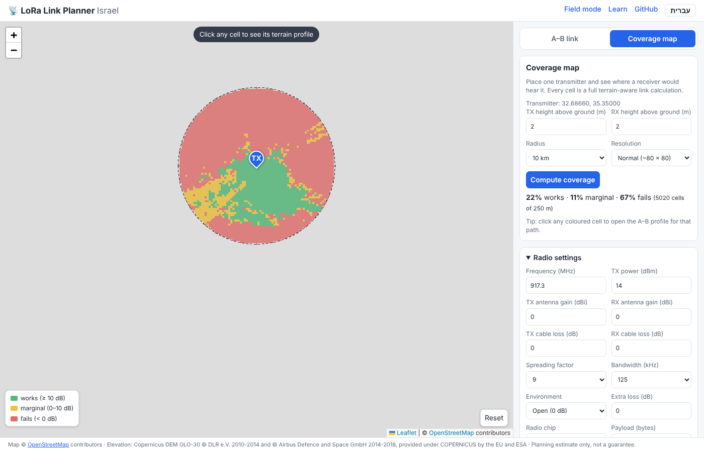
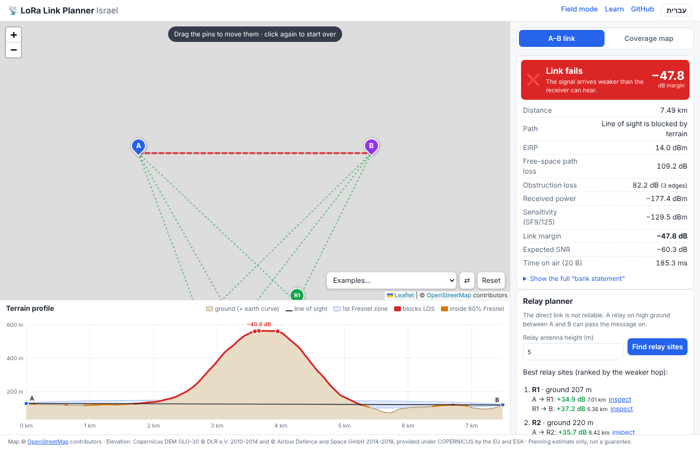
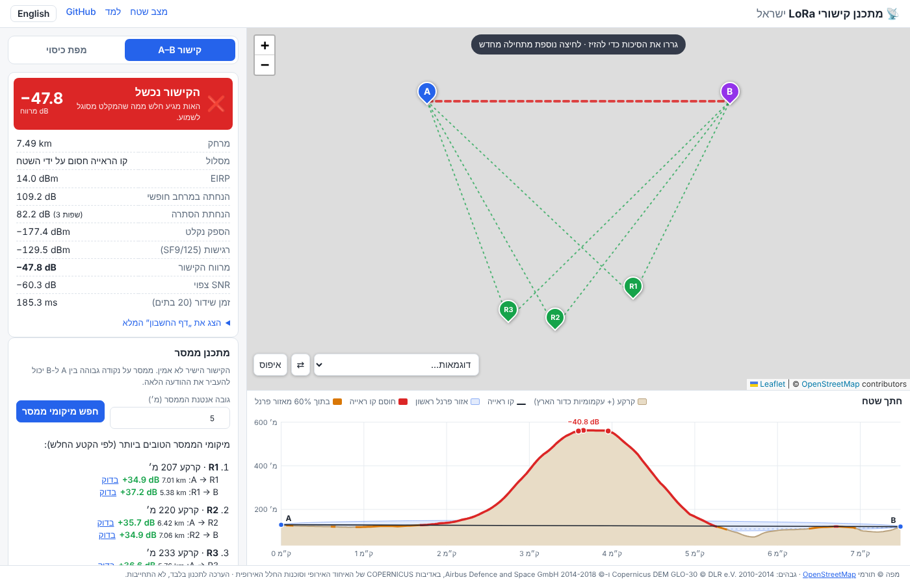
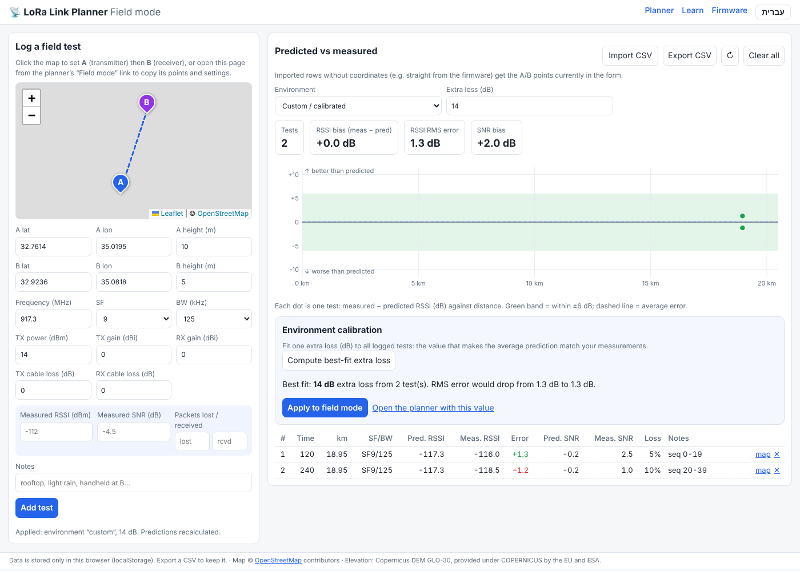

# 📡 LoRa Link Planner — Israel

**"If I put one LoRa device here and another there, will the message get through?"**

Click two points on a map of Israel. The planner draws the real terrain
between them, the line of sight and the Fresnel zone, adds up every gain and
loss, and gives you a verdict (**works / marginal / fails**) with the link
margin in dB. Every formula is explained in plain language in
[docs/LEARN.md](docs/LEARN.md), so it works as a teaching tool too.

**Live demo:** https://arielhone.github.io/lora-link-planner/ · [עברית](https://arielhone.github.io/lora-link-planner/) (switch with the button at the top)


<sub>Screenshots were taken in an offline sandbox, so the OpenStreetMap
background is blank; in the live app the map shows normally.</sub>

| Coverage map | Relay planner | עברית (RTL) |
| --- | --- | --- |
|  |  |  |

| Hill in the way | Field mode + calibration | Mobile |
| --- | --- | --- |
|  |  |  |

## Features

**A–B link view**
- **Map of Israel** (Leaflet + OpenStreetMap). Click to place A and B, then
  drag the pins to move them.
- **Real terrain** from the Copernicus GLO-30 elevation model, preprocessed
  into small tiles that ship with the site. No elevation API calls and no
  rate limits.
- **Terrain profile chart**: ground (with Earth curvature added), straight
  line of sight, first Fresnel zone as a shaded ellipse, a dashed 60%
  clearance line, red where terrain blocks the line of sight, orange where it
  enters 60% of the Fresnel zone, and each diffraction edge with its loss.
  Hover to read heights and clearance.
- **Result card**: distance, EIRP, free-space loss, obstruction loss,
  environment loss, received power, sensitivity, margin, expected SNR, time
  on air, plus the full "bank statement".
- **What if…**: margin and air time for every SF (with a one-click "use"),
  and the antenna heights needed to clear 60% of the Fresnel zone (both
  antennas, or only A, or only B; one click to apply).

**Coverage map**
- Place one transmitter and choose a radius (5–30 km), receiver height and
  resolution. The planner runs a full link calculation to every cell of a
  grid (~5,000 or ~20,000 cells) **in a Web Worker** with a progress bar,
  so the page never freezes.
- The result is drawn as a semi-transparent heat map (green = works,
  yellow = marginal, red = fails) with a legend and a summary. Hover a cell
  to read its margin, and click it to open that path in the A–B view.

**Relay planner**
- When the direct link is marginal or fails, search the terrain for relay
  sites: high ground inside an ellipse around A and B, ranked by the weaker
  of the two hop margins. The top 3 are shown on the map with both hop
  margins; one click inspects each hop's profile.

**Environment and calibration**
- **Environment** setting: open (0 dB), suburban (+10 dB), urban (+20 dB)
  or custom. The defaults are based on ITU-R P.2108 and Okumura–Hata
  ([details](DECISIONS.md#7-environment-clutter-loss)).
- **Field mode**: log real RSSI/SNR measurements, see predicted vs measured,
  get a prediction-error chart, and import/export CSV (stored in your
  browser). **Compute best-fit extra loss** fits the environment loss to
  your measurements, and you can apply it in one click.

**Everything else**
- **Israeli defaults**: 917.3 MHz, 14 dBm EIRP (AS923-4), with a warning
  when your settings go outside the band or the power limit
  ([sources](DECISIONS.md#1-frequency-band-and-power-for-israel)).
- **Hebrew / English**: full right-to-left Hebrew UI. It follows the
  browser language and can be switched with one click. All strings are in
  [`src/i18n/strings.js`](src/i18n/strings.js).
- **Shareable links**: mode, points and settings are stored in the URL hash.
- **Range-test firmware** for the Heltec WiFi LoRa 32 V3
  ([firmware/](firmware/README.md)). It prints CSV that Field mode imports
  directly.
- Works on phones.

## How to use it

**Check one link (A–B tab).** Click the map for A (transmitter), then B
(receiver), or pick an *Example*. Set the antenna heights and radio settings
on the right. Read the verdict, look at the terrain profile below the map, and
use *What if…* to find a faster SF or the mast height you need. *Field mode*
in the header opens the logging page with the same points and settings.

**Find a relay.** If the verdict is *marginal* or *fails*, the *Relay
planner* card appears. Set the relay antenna height and press *Find relay
sites*. R1–R3 appear on the map; *inspect* opens a hop, and *Back to A–B*
returns to the original link.

**Map coverage (Coverage map tab).** Click the map to place the transmitter
(or keep point A), set the radius, the receiver height and the resolution,
and press *Compute coverage*. Click any coloured cell to see why it's that
colour.

**Calibrate with real measurements (Field mode).** Log tests by hand, or
import the CSV printed by the range-test firmware. When you have a few,
press *Compute best-fit extra loss*. *Apply to field mode* uses it for all
predictions, and *Open the planner with this value* carries it to the
planner as a custom environment.

## How it works

```
 click A, B ──► src/elevation/profile.js ──► sample terrain every 30 m
                     │                         (tiles from public/dem/, bilinear)
                     ▼
              src/physics/pathAnalysis.js
                ├─ propagation.js   free-space loss, Fresnel radius, earth bulge (k = 4/3)
                ├─ diffraction.js   knife edge ν → J(ν), Deygout multi-edge (ITU-R P.526)
                ├─ clutter.js       environment loss (presets, ITU-R P.2108 reference)
                ├─ lora.js          sensitivity per SF/BW, required SNR, time on air (Semtech)
                └─ linkBudget.js    EIRP − losses + gains − sensitivity = margin → verdict
                     │
                     ├──► src/app/          map, profile chart (SVG), result card, what-if, URL state
                     └──► Web Worker        src/coverage/ (grid of links) · src/relay/ (relay search)
```

The physics modules are pure functions with no DOM or network access, and
are unit-tested against reference values (ITU-R P.525/P.526 figures, Semtech
datasheet tables and the Semtech air-time calculator). See
[DECISIONS.md](DECISIONS.md) for every modelling choice and its tradeoffs, and
[docs/LEARN.md](docs/LEARN.md) for the physics explained from zero.

## Run locally

Requires Node.js 18+ (22 recommended).

```bash
npm install
npm run dev          # http://localhost:5173
```

```bash
npm test             # unit tests (node:test, no extra dependencies)
npm run build        # static site in dist/
npm run preview      # serve dist/ on http://localhost:4173
```

End-to-end check in headless Chromium (needs Playwright):

```bash
npm install --no-save playwright && npx playwright install chromium
npm run build && (npx vite preview --port 4173 &) && npm run e2e
```

## Rebuild the elevation data

The tiles in `public/dem/` (~13 MB) are generated by
`scripts/build_dem.py` from the Copernicus GLO-30 DEM on AWS Open Data. You
only need to re-run it to change the resolution or the area:

```bash
pip install -r scripts/requirements.txt
python scripts/build_dem.py               # 2 arc-seconds (~60 m), default
python scripts/build_dem.py --arcsec 1    # full 30 m resolution (~4× bigger)
```

Details and options: [scripts/README.md](scripts/README.md).

## Deploy

`.github/workflows/pages.yml` builds and deploys to GitHub Pages on every
push to `main`. In the repository settings, set **Pages → Source** to
**GitHub Actions** once. `.github/workflows/ci.yml` runs the unit tests,
the build, the headless end-to-end check and the firmware compile on every
push.

## Project layout

```
src/physics/      pure, tested RF + LoRa models
src/elevation/    DEM tile reader, great-circle sampling
src/app/          planner page (map, chart, result, what-if, relay, coverage UI, URL state)
src/coverage/     coverage grid, computation and the Web Worker
src/relay/        relay site search
src/i18n/         translations (Hebrew / English) and the helper
src/field/        field mode page, CSV format, error statistics, calibration
public/dem/       preprocessed elevation tiles + manifest
scripts/          build_dem.py (elevation pipeline), e2e-check.mjs
firmware/         PlatformIO range-test firmware (Heltec V3, RadioLib)
docs/LEARN.md     the physics, explained from zero
test/             unit tests
```

## Accuracy, honestly

This is a planning estimate: free-space loss plus terrain diffraction. It
does not model buildings, trees or reflections as separate objects, so
expect reality to be worse than predicted in cities and forests. That's
what the 10 dB "works" margin is for, and what Field mode lets you measure.
See [SUMMARY.md](SUMMARY.md#known-limitations).

## License

Code: [MIT](LICENSE). Elevation data: Copernicus DEM GLO-30 © DLR e.V.
2010-2014 and © Airbus Defence and Space GmbH 2014-2018, provided under
COPERNICUS by the European Union and ESA. Map data © OpenStreetMap
contributors.
